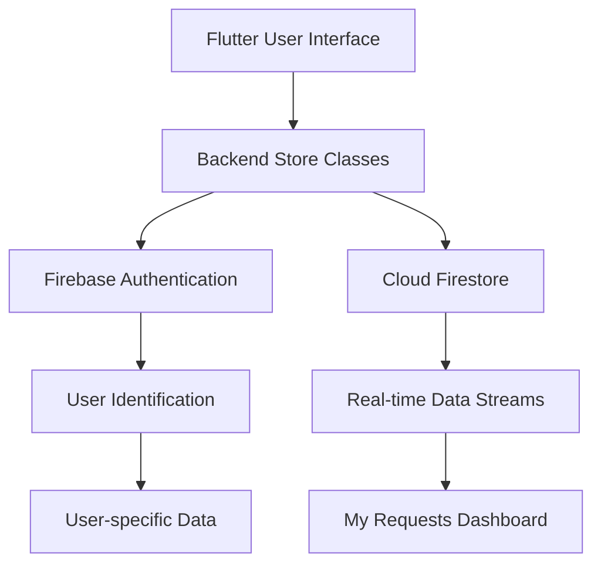

<div align="center">

# 🏥 CareLink

### Connecting Care, Technology & People

A modern healthcare assistance application designed to simplify
access to care services through a secure and user-friendly
mobile platform.


</div>

---

## 📖 About the Project

**CareLink** is a healthcare assistance mobile application built
using Flutter and Firebase. It aims to simplify healthcare
management by bringing essential care-related services into
a single digital platform.

The application focuses on accessibility, convenience,
real-time data management and a user-friendly experience.

---

## 🎯 Project Objectives

- Simplify access to healthcare-related services.
- Reduce manual healthcare record management.
- Provide a centralized platform for care requests.
- Enable real-time data storage and retrieval.
- Deliver a reliable and accessible mobile experience.

---

## 👶 Child Care Module

The Child Care module provides parents and guardians with
a centralized platform to manage children's healthcare
records and care-related requests.

| Feature | Description |
| :--- | :--- |
| 🍼 **Baby Health Records** | Create and manage children's health information. |
| 🩺 **Sick Child Care** | Submit and manage child care assistance requests. |
| 💊 **Pediatric Medicine** | Create and track pediatric medicine requests. |
| 🧸 **Baby Equipment Rental** | Submit and manage baby equipment rental requests. |
| 👨‍⚕️ **Pediatrician Locator** | Browse demo pediatrician profiles and request appointments. |
| 🚑 **Emergency Transport** | Create and manage demonstration transport requests. |
| 📋 **My Requests** | View all care-related requests in one centralized screen. |

---

## ✨ Key Features

- Firebase Authentication integration
- Cloud-based data storage
- Real-time Firestore synchronization
- Create, Read, Update and Delete operations
- User-specific request management
- Input validation and error handling
- Centralized request history
- Automatic timestamp management
- Responsive and user-friendly interface
- Modular and maintainable code structure

---

## 🛠️ Technology Stack

| Technology | Purpose |
| :--- | :--- |
| **Flutter** | Cross-platform application development |
| **Dart** | Application programming language |
| **Firebase Authentication** | User authentication and identification |
| **Cloud Firestore** | Cloud database and real-time data storage |
| **Firebase Core** | Firebase application initialization |
| **Git & GitHub** | Version control and team collaboration |
| **Visual Studio Code** | Development environment |

---

## 🏗️ Backend Architecture

The backend follows a modular structure that separates
the user interface, data operations and database management.



Each module has a dedicated backend store responsible
for communicating with Firebase and managing its data operations.

---

## 🗄️ Database Structure

The Child Care backend uses the following Firestore collections:

| Collection | Purpose |
| :--- | :--- |
| `baby_health_records` | Children's health records |
| `child_care_requests` | Sick child care requests |
| `pediatric_medicine_requests` | Medicine requests |
| `baby_equipment_rentals` | Equipment rental requests |
| `pediatricians` | Demo pediatrician directory |
| `pediatrician_appointments` | Appointment requests |
| `emergency_transport_requests` | Demo transport requests |

Firebase Authentication provides user identification,
while Firestore streams enable real-time updates throughout
the application.

---

## 📂 Project Structure

```text
CareLink/
│
├── android/
├── lib/
│   ├── main.dart
│   └── src/
│       └── features/
│           └── home/
│               └── presentation/
│                   ├── Screens
│                   └── Backend Stores
│
├── pubspec.yaml
└── README.md
```

---

## 🚀 Getting Started

### Prerequisites

Make sure the following tools are installed:

- Flutter SDK
- Dart SDK
- Android Studio or Visual Studio Code
- Git
- Access to the configured Firebase project

### Installation

**1. Clone the repository**

```bash
git clone https://github.com/H3shanG/CareLink.git
```

**2. Navigate to the project directory**

```bash
cd CareLink
```

**3. Install dependencies**

```bash
flutter pub get
```

**4. Check the application for code issues**

```bash
flutter analyze
```

**5. Run the application**

```bash
flutter run
```

Ensure that Firebase is correctly configured before
running the application.

---

## 📊 Development Status

| Module | Status |
| :--- | :--- |
| Baby Health Records | ✅ Implemented |
| Sick Child Care | ✅ Implemented |
| Pediatric Medicine | ✅ Implemented |
| Baby Equipment Rental | ✅ Implemented |
| Pediatrician Locator | ✅ Implemented |
| Emergency Transport | ✅ Implemented |
| My Requests Integration | ✅ Implemented |
| Flutter Static Analysis | ✅ Passed |
| Firebase Security Rules | 🔄 Pending verification |
| Functional Testing | 🔄 Pending |

---

## 🔮 Future Improvements

- Enhanced Firebase security rules
- Comprehensive functional and integration testing
- Healthcare provider verification
- Appointment confirmation systems
- Push notification integration
- Improved service tracking
- Performance and accessibility improvements

---

## ⚠️ Disclaimer

CareLink is currently a healthcare assistance project
under development.

Pediatrician profiles, appointment requests and emergency
transport services are intended for demonstration purposes.
The application does not provide confirmed medical appointments
or real ambulance dispatch.

Use fictional information during development and testing.

---

## 🤝 Contributors

Developed collaboratively as a group software development project.

Each contributor is responsible for implementing, maintaining
and improving their assigned application modules.

[](https://github.com/H3shanG/CareLink/graphs/contributors)

---

<div align="center">

### 💙 CareLink — Care Made Closer

*Bringing healthcare assistance closer through technology.*

⭐ Star this repository if you find the project interesting!

**Built with Flutter & Firebase**

</div>
